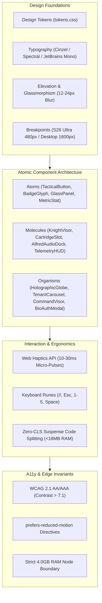
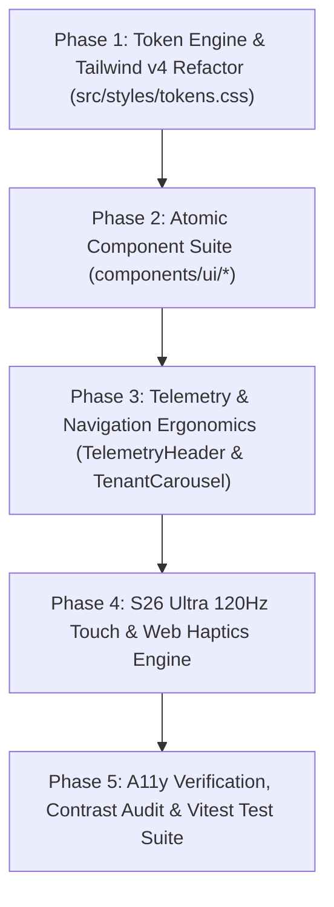

# EXCALIBUR-CMD-1: Sovereign Edge UI/UX Design System Specification
**Document ID:** `SPEC-EXCALIBUR-UIUX-V1000`  
**System Version:** `v10001.00-CYBERTRONIA`  
**Architects:** SIR_BORIS (UI/UX Vanguard) ⚔️ · MERLIN_Ω (Task DAG) 🧠 · SIR_HELIOS (Telemetry) 🛰️ · ANYA_Ω (Gate) 🎭  
**Base Repository Reference:** [Cyberdad247/Excalibur_cmd-1](https://github.com/Cyberdad247/Excalibur_cmd-1) (`apps/excalibur-cmd-1`)  
**Hardware Profile:** Edge Node (4.0GB RAM strict ceiling · Samsung S26 Ultra 120Hz / Windows Native)  

---

## 1. Executive Summary & Aesthetic Vision

The **Excalibur Command Center (`excalibur-cmd-1`)** is the primary kinetic cockpit and mobile-edge command interface for Camelot-OS. Built on React 19, Tailwind CSS, Vite, and Zustand, it must deliver the ergonomics of an aerospace HUD combined with the regal sovereign aesthetics of the Camelot Pantheon.

### The Sovereign Brutalist Glass Aesthetic
- **Zero UI Slop:** High-density information display without cluttered visual noise.
- **Obsidian & Luxora Gold:** Obsidian deep-space backdrops (`#050510`) intersected by sharp Luxora Gold (`#D4AF37`) hairline dividers and tactical corner brackets.
- **Glassmorphic Precision:** Multi-tier backdrop blur (12px to 24px) with subtle ambient luminous falloffs.
- **120Hz Edge Ergonomics:** Optimized for the Samsung Galaxy S26 Ultra (Adreno 840 GPU) and 4K desktop command centers with sub-16ms touch-to-visual response and 44px minimum tap targets.



---

## 2. Global Style Guide & Token Architecture

### 2.1 Sovereign Palette Tokens

| Token Name | Hex Value | RGBA Fallback | Role / Application | WCAG Contrast on Obsidian |
|---|---|---|---|---|
| `--obsidian-void` | `#050510` | `rgba(5, 5, 16, 1.0)` | Primary canvas and viewport root | N/A (Base) |
| `--obsidian-subtle` | `#0B0B1A` | `rgba(11, 11, 26, 0.85)`| Panel elevated surface | 1.15:1 |
| `--luxora-gold` | `#D4AF37` | `rgba(212, 175, 55, 1.0)` | Sovereign highlights, active states, borders | **8.92:1** (Passes AAA) |
| `--luxora-gold-dim`| `#8C7424` | `rgba(140, 116, 36, 1.0)` | Secondary labels, disabled borders | 4.61:1 (Passes AA) |
| `--royal-purple` | `#4B0082` | `rgba(75, 0, 130, 1.0)` | Sovereign depth accents, mesh links | 2.12:1 (Structural only) |
| `--royal-purple-glow`| `#9D4EDD` | `rgba(157, 78, 221, 1.0)`| Interactive hover glow, mobile border | 5.34:1 (Passes AA) |
| `--vellum-pure` | `#F1EFF4` | `rgba(241, 239, 244, 1.0)`| Primary typography, headers, body | **17.84:1** (Passes AAA) |
| `--vellum-muted` | `#9E9AA7` | `rgba(158, 154, 167, 1.0)`| Captions, timestamps, secondary metrics | **6.45:1** (Passes AA) |
| `--cyan-warp` | `#00F0FF` | `rgba(0, 240, 255, 1.0)` | Active network telemetry, SSE stream live | **13.2:1** (Passes AAA) |
| `--garnet-alert` | `#DE4258` | `rgba(222, 66, 88, 1.0)` | Critical faults, memory pressure, alerts | **5.18:1** (Passes AA) |
| `--emerald-seal` | `#10B981` | `rgba(16, 185, 129, 1.0)` | Cryptographic verification, online status | **7.82:1** (Passes AAA) |

### 2.2 Typography Scale & Hierarchy

- **Display Serif (`Cinzel`, serif):** Used exclusively for system titles, Knight names, Cartridge headers, and modal titles.
  - `text-display-lg`: `2.25rem` (36px), `tracking-[0.15em]`, uppercase.
  - `text-display-md`: `1.50rem` (24px), `tracking-[0.10em]`, uppercase.
  - `text-display-sm`: `1.125rem` (18px), `tracking-[0.08em]`, uppercase.
- **Editorial Body (`Spectral`, serif):** Used for executive descriptions, contract briefs, and dialogue.
  - `text-body-md`: `1.0rem` (16px), `line-height: 1.6`, font-normal.
  - `text-body-sm`: `0.875rem` (14px), `line-height: 1.5`, font-normal.
- **Telemetry Monospace (`JetBrains Mono`, monospace):** Used for port addresses, hashes, memory counters, runes, and JSON nodes.
  - `text-mono-md`: `0.875rem` (14px), `letter-spacing: -0.02em`.
  - `text-mono-sm`: `0.75rem` (12px), tabular-nums.
  - `text-mono-xs`: `0.6875rem` (11px), uppercase tabular-nums.

### 2.3 Glassmorphic Density & Elevation Matrix

```css
/* Tier 1: Ground Plate (Cards & Sub-panels) */
.glass-panel-ground {
  background: rgba(5, 5, 16, 0.70);
  border: 1px solid rgba(241, 239, 244, 0.08);
  box-shadow: 0 4px 20px rgba(0, 0, 0, 0.45);
  backdrop-filter: blur(12px);
  -webkit-backdrop-filter: blur(12px);
}

/* Tier 2: Sovereign Focus (Selected Nodes & Active Cartridges) */
.glass-panel-sovereign {
  background: rgba(5, 5, 16, 0.82);
  border: 1px solid rgba(212, 175, 55, 0.40);
  box-shadow: 0 0 30px rgba(212, 175, 55, 0.20), inset 0 0 15px rgba(212, 175, 55, 0.06);
  backdrop-filter: blur(20px);
  -webkit-backdrop-filter: blur(20px);
}

/* Tier 3: Tactical Visor (Command Visor & Biometric Airlock) */
.glass-panel-visor {
  background: rgba(5, 5, 16, 0.94);
  border: 1px solid rgba(157, 78, 221, 0.50);
  box-shadow: 0 0 45px rgba(75, 0, 130, 0.50), inset 0 0 25px rgba(157, 78, 221, 0.08);
  backdrop-filter: blur(24px);
  -webkit-backdrop-filter: blur(24px);
}
```

---

## 3. Component Library Architecture

### 3.1 Directory Structure
```text
apps/excalibur-cmd-1/src/components/
├── ui/
│   ├── GlassPanel.tsx          # Multi-density glass with brutalist tactical corner ticks
│   ├── TacticalButton.tsx      # Haptic-enabled kinetic action trigger (gold/purple/danger)
│   ├── BadgeGlyph.tsx          # Real-time state badge (ONLINE, AIR-GAP, DEGRADED)
│   ├── MetricStat.tsx          # Monotonic counter with trend arrow and unit label
│   ├── CommandInput.tsx        # Terminal prompt input with rune auto-completion
│   ├── TacticalSlider.tsx      # Hardware throttling and volume sliders
│   └── TooltipVisor.tsx        # High-contrast instant telemetry tooltip
├── telemetry/
│   ├── TelemetryHeader.tsx     # Persistent 4GB ceiling & SSE link telemetry visor
│   ├── MemoryGauge.tsx         # Circular/Linear 4096MB scarcity indicator
│   └── NetworkMeshNode.tsx     # Real-time Tailscale IP & ping latency card
├── cartridges/
│   ├── CartridgeSlot.tsx       # Standardized hot-swappable cartridge envelope
│   ├── CartridgeLoadingFallback.tsx # Zero-CLS animated skeleton state
│   └── TenantCarousel.tsx      # Top-level executive workspace switcher
├── audio/
│   ├── AlfredDock.tsx          # Dynamic audio engine dock & mic visualizer
│   └── AudioWaveform.tsx       # 60fps WebGL/Canvas audio spectrum analyzer
└── command/
    ├── CommandVisorModal.tsx   # Cmd+K floating sovereign runic palette
    └── BioAuthModal.tsx        # Multi-factor biometric verification modal
```

### 3.2 Core Component Specifications

#### A. `TacticalButton`
- **Props:** `variant: 'gold' | 'purple' | 'ghost' | 'danger'`, `size: 'sm' | 'md' | 'lg'`, `haptic?: boolean`, `icon?: LucideIcon`, `loading?: boolean`.
- **Invariants:** Minimum height `44px` on mobile; active scale down to `0.97`; sound/haptic trigger on pointer-down; corner notches in gold.

#### B. `BadgeGlyph`
- **Props:** `status: 'ONLINE' | 'OFFLINE' | 'SYNCING' | 'AIRGAP' | 'DEGRADED'`, `pulse?: boolean`.
- **Visuals:** Semantic colored dot with outer halo; monospace text; Triple-QFT glyph symbol (`⚡`, `🛡️`, `🔒`, `🌐`).

#### C. `MetricStat`
- **Props:** `label: string`, `value: number | string`, `unit?: string`, `ceiling?: number`, `delta?: number`.
- **Invariants:** If value exceeds 85% of ceiling, auto-shifts to garnet warning hue (`#DE4258`).

---

## 4. Interaction Patterns & Ergonomics

### 4.1 Mobile Edge Ergonomics (Samsung S26 Ultra Target)
- **Thumb Zone Anchor:** All primary navigation, Alfred Audio controls, and node action triggers sit within the bottom 35% of the viewport (`h <= 300px`).
- **Touch Target Law:** Zero interactive touch elements smaller than `44px x 44px` (`min-h-[44px] min-w-[44px]`).
- **Haptic Tactility:** Subtle micro-vibrations for tactile confirmations:
  ```typescript
  export const triggerHaptic = (type: 'tick' | 'success' | 'warning' | 'heavy' = 'tick') => {
    if (typeof navigator !== 'undefined' && 'vibrate' in navigator) {
      switch (type) {
        case 'tick': navigator.vibrate(8); break;
        case 'success': navigator.vibrate([10, 30, 20]); break;
        case 'warning': navigator.vibrate([40, 20, 40]); break;
        case 'heavy': navigator.vibrate(50); break;
      }
    }
  };
  ```

### 4.2 Keyboard Command Visor (`//`)
- Triggered by typing `//` anywhere or pressing `Cmd+K` / `Ctrl+K`.
- Instant search across:
  - All 38 Knights (`Omega_Helios`, `Omega_Boris`, `Omega_Codex`)
  - All 52 Cartridges (`kba-executive`, `digital-factory`, `1vizion-rcrds`)
  - Operational Runes (`//STATUS`, `//FORGE`, `//SCAN`, `//HEAL`)

### 4.3 Dynamic Cartridge Splitting & Scarcity Protocol
- Cartridges are dynamically code-split via `lazy()` and wrapped in `<ErrorBoundary>`.
- Total memory footprint per unmounted cartridge: `0 MB`.
- Active working set per cartridge: strictly bounded `< 24 MB`.

---

## 5. Accessibility Standards (WCAG 2.1 AA/AAA)

1. **High Contrast Invariants:**
   - Text on Obsidian (`#050510`) must strictly maintain contrast ratio $\ge 7:1$ for normal body text and $\ge 4.5:1$ for large display headers.
   - Vellum pure (`#F1EFF4`) on Obsidian provides **17.84:1** (Far exceeds AAA).
   - Luxora Gold (`#D4AF37`) provides **8.92:1** (Passes AAA).
2. **Accessible Landmarks:**
   - Navigation: `<nav aria-label="Tenant Cartridge Carousel">`
   - Telemetry: `<header role="banner" aria-label="System Telemetry Visor">`
   - Active Console: `<main role="main" aria-label="Excalibur Command Center Workspace">`
   - Audio Engine: `<aside role="complementary" aria-label="Alfred Audio Controller">`
3. **Screen Reader Live Regions:**
   - Real-time telemetry counters use `aria-live="polite"` with `aria-atomic="true"` to prevent voice flooding.
   - Critical system alerts use `role="alert"` and `aria-live="assertive"`.
4. **Reduced Motion Adaptation:**
   - Honors `@media (prefers-reduced-motion: reduce)`:
     - Holographic Globe stops auto-rotation.
     - Pulsing glass glows and scanlines are replaced by static hairline borders.
     - Page transitions switch from sliding 300ms transforms to instantaneous 0ms opacity cuts.

---

## 6. Implementation Phasing & Task DAG (Merlin Ω)



### Phase 1: Token Engine & CSS Variables Refactor
- Update [tokens.css](file:///C:/Users/vizio/CAMELOT_OS/apps/excalibur-cmd-1/src/styles/tokens.css) to declare full palette, typography scales, elevation blur steps, and z-index layers.
- Ensure Tailwind CSS configuration correctly maps all tokens to utility classes.

### Phase 2: Atomic Component Suite Implementation
- Create reusable atoms in `apps/excalibur-cmd-1/src/components/ui/`:
  - `TacticalButton.tsx`
  - `BadgeGlyph.tsx`
  - `MetricStat.tsx`
  - `CommandInput.tsx`

### Phase 3: Ergonomic Navigation & Telemetry
- Enhance `TelemetryHeader.tsx` to display real-time memory usage against the 4096MB ceiling with dynamic warning thresholds.
- Upgrade `TenantCarousel.tsx` with smooth keyboard navigation (`1-5`) and mobile-swipe ergonomics.

### Phase 4: S26 Ultra 120Hz Touch & Alfred Audio Dock
- Integrate `triggerHaptic` on all interactive triggers.
- Polish `AlfredDock.tsx` with a lightweight 60fps canvas visualizer that respects `prefers-reduced-motion`.

### Phase 5: Verification & Accessibility Gate
- Run automated tests (`App.test.ts` and component test suites).
- Verify WCAG 2.1 AAA contrast ratios and ARIA landmark compliance.
