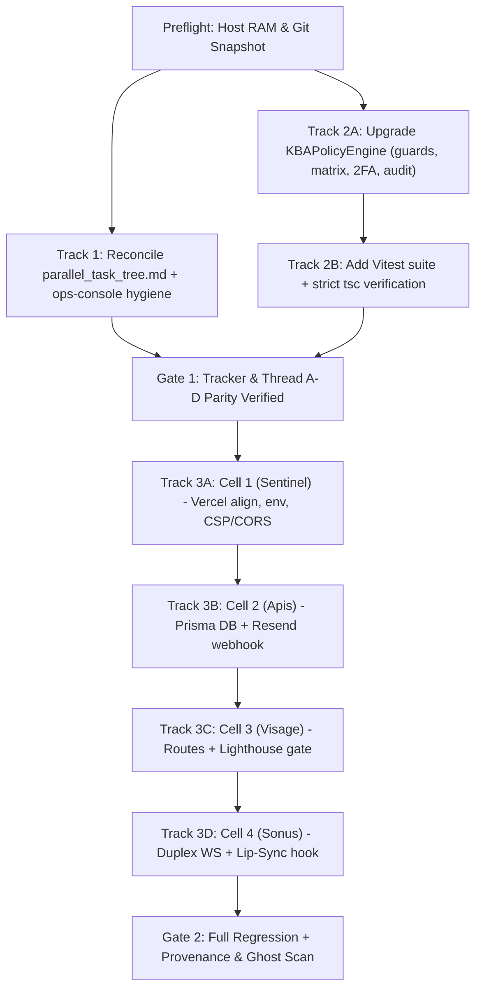

# Camelot-OS Swarm Reconciliation, Policy Engine Completion & Invisioned Handoff Blueprint

Generated: 2026-11-25  
Active Branch: `feat/invisioned-marketing-digital-factory`  
Runic Dispatch: `//PLAN` (Sir Alex — Task DAG & AST Plan Mode; Anya — Egress Synthesis)

## Objective

Close the gap between Camelot-OS's documented swarm state and live runtime code across three ordered tracks, while respecting the bare-metal host's **8 GB RAM server ceiling** (currently ~6.87 / 7.71 GB):

1. **Track 1 — Swarm Tracker & Placeholder Reconciliation:** Update `parallel_task_tree.md` to reflect verified disk/build reality across Threads A–D, and resolve placeholder hygiene drift in `apps/operations-console/`.
2. **Track 2 — Thread D Completion (`@camelot/policy-engine`):** Upgrade `packages/policy-engine/src/index.ts` from a basic role/edge checker into a full HITL enforcement engine implementing the guards, 2FA/RBAC transition matrix, timeout checks, and JSONL audit schema defined in `packages/policy-engine/schemas/approval-states.yaml`, backed by a Vitest suite.
3. **Track 3 — Sequenced Handoff to `invisioned-marketing` Production Integration:** Establish a memory-safe, gated execution order for the 9 open tasks in `docs/superpowers/plans/2026-10-15-invisioned-marketing-production-integration.md` (Cells 1–4).

---

## Architecture & Task DAG

---

## Skepticism & Risk Gates

### Operator Experience (Sir Alex)
- **Current risk:** `parallel_task_tree.md` still shows all 4 threads as `EXECUTING` with stale paths (`apps/operations-console/vercel.json`) and a stale Tailscale IP (`100.71.218.75`), causing operators and agents to chase already-superseded artifacts.
- **Design requirement:** Every thread in `parallel_task_tree.md` must carry an evidence-backed status (`SUPERSEDED/MOVED`, `COMPLETE`, `PARTIAL -> COMPLETE`) linked to real files and live verification commands.

### Security & Resource Governance (Sir Sentinel / Global Laws 3 & 4)
- **Current risk 1 (Unenforced HITL Guards):** `packages/policy-engine/schemas/approval-states.yaml` declares `RiskScoreCheck` (`risk_entropy < 75`), `MemoryCeilingCheck` (`ram_usage_mb < 7168`), `requires_2fa: true`, and `NoSecretExposure`, but `KBAPolicyEngine` currently ignores all of them.
- **Current risk 2 (Placeholder Drift):** `apps/operations-console/README.md` forbids any files besides `README.md` and `deployment-notes.md`, yet `.vercel`, `.env.local`, and `.env.production` exist in that folder. Removing or relocating env files requires explicit HITL confirmation so active Vercel links or local credentials are not accidentally lost.
- **Current risk 3 (RAM Ceiling):** Host RAM sits at ~6.87–7.28 / 7.71 GB. Running Next.js builds, Rust `cargo`, and Go `go test` concurrently risks paging/OOM. All tracks must run **sequentially**, never in parallel build shells.

---

## Proposed Implementation Design

### Track 1: Swarm Reconciliation (`parallel_task_tree.md`)
- Update Hardware Baseline IP from `100.71.218.75` to `100.110.180.18` (matching `apps/bifrost/main.go`).
- Update Thread Status Matrix:
  - **Thread A (`SIR BORIS`):** `SUPERSEDED (Consolidated into apps/pwa)` → `apps/pwa/src/components/operator_console/OperatorConsole.tsx`.
  - **Thread B (`SIR CODA`):** `COMPLETE (Verified)` → `apps/bifrost/main.go` (`go test ./...` passes).
  - **Thread C (`SIR CODEX`):** `COMPLETE (Compiles)` → `wasm/ledger-engine/src/lib.rs` (`cargo check` passes).
  - **Thread D (`LADY ALEXANDRIA`):** `COMPLETE (After Track 2)` → `packages/policy-engine/schemas/approval-states.yaml` + `packages/policy-engine/src/index.ts`.
- Audit `apps/operations-console/` `.vercel` / `.env.*` files: confirm whether they are tracked by git (`git ls-files`) and either relocate/ignore or document an explicit waiver with operator approval.

### Track 2: `@camelot/policy-engine` Full HITL Enforcement (`packages/policy-engine/`)
Extend `packages/policy-engine/src/index.ts` with backward-compatible signatures plus a rich `evaluateTransition(request)` API:

1. **Typed Schema Contracts:**
   - Add `TransitionMatrixRule` (`from`, `to`, `trigger`, `rbac?`, `requires_2fa?`, `guard?`) and `AuditLoggingConfig` (`destination`, `include_fields`) to `ApprovalStateMachineSchema`.
2. **Structured Evaluation Context (`TransitionContext`):**
   - `userRoles: string[]`
   - `trigger?: string`
   - `twoFactorVerified?: boolean`
   - `riskEntropy?: number`
   - `nodeRamUsageMb?: number`
   - `proposedDiff?: string`
   - `overrideTokenProvided?: boolean` (boolean attestation only — never store or log raw secrets)
   - `elapsedSeconds?: number`
   - `operatorId?: string`, `transactionId?: string`, `signature?: string`
3. **Guard Evaluators (Fail-Closed):**
   - `RiskScoreCheck`: fails if `riskEntropy === undefined || riskEntropy >= 75` → returns `requiredAction: 'REQUIRE_MULTI_SIG'`.
   - `MemoryCeilingCheck`: fails if `nodeRamUsageMb === undefined || nodeRamUsageMb >= 7168` → blocks execution to protect the 8 GB ceiling.
   - `NoSecretExposure`: scans `proposedDiff` for high-confidence secret patterns (API keys, private key headers, bearer tokens) → denies if detected.
   - `ASTSyntaxValidator`: accepts an injectable validator callback (defaulting to non-empty balanced syntax check) so callers can plug in language-specific AST parsers without bloating the package.
   - **Matrix Enforcement:** If a `transitions_matrix` entry matches `(from, to)`, enforce its `rbac`, `requires_2fa`, and `guard` in addition to state-level `allowed_transitions`.
   - **Terminal State Lock:** Reject any transition out of states with `is_terminal: true` (`COMPLETED`, `REJECTED`, `CANCELLED`, `CRITICAL_HALT`).
   - **Audit Emission:** Produce a structured `HitlAuditRecord` matching `audit_logging.include_fields` and provide an opt-in `appendAuditRecord(record, auditPath?)` helper writing JSONL to `03_VAULT/runtime_state/hitl_audit_ledger.jsonl` (never touching `PROVENANCE_LEDGER.md`).

### Track 3: `invisioned-marketing` Sequential Execution Order
Execute the 9 open tasks in `docs/superpowers/plans/2026-10-15-invisioned-marketing-production-integration.md` in strict dependency order, one Cell at a time:
1. **Cell 1 (Sentinel):** `vercel.json` alignment → env var audit + `squires.colony ghost` → CSP/CORS headers.
2. **Cell 2 (Apis):** Prisma `packages/db` + JSONL fallback in `lead/route.ts` and `proposal/route.ts` → Resend email webhook.
3. **Cell 3 (Visage):** Public route assembly (`/`, `/proposal`, `/command`, `/portal`, `/canvas`) → bundle/font performance gate.
4. **Cell 4 (Sonus):** Duplex WebSocket signaling in `oracle/route.ts` → Web Audio API 16-bar lip-sync hook.

---

## Expected Outcome

- Zero discrepancy between `parallel_task_tree.md` and actual repository artifacts.
- Thread D's HITL policy engine enforces every security guard in `approval-states.yaml` with automated Vitest proof.
- Clear, memory-safe runway to complete all 9 `invisioned-marketing` production integration tasks without breaching the 8 GB server RAM ceiling.
