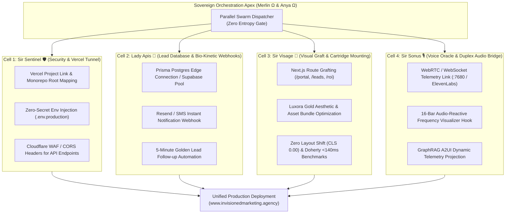

# Production Integration Plan: Parallel Swarm Bio-Kinetic Integration with www.invisionedmarketing.agency

**Target Environment:** `https://www.invisionedmarketing.agency` (Active Next.js on Vercel Edge)  
**Control Plane:** Camelot-OS v10001.00-CYBERTRONIA  
**Sovereign Apex:** Merlin Ω 🧙‍♂️ ⚡ Anya Ω 🎭 ⚡ Sir Helios 🛡️  
**Date:** 2026-10-15  
**Crystal Tether:** `vfs://worldtree/crystals/vkg_5bb18d058c279f76.vkg`  

---

## 🏛️ Executive Summary & Discovery Findings

A live probe of `https://www.invisionedmarketing.agency` confirms:
1. **Host Environment:** Deployed directly on **Vercel** with Next.js edge caching and asset bundles.
2. **Current Identity:** *"Invisioned Marketing | AI-Powered Digital Marketing Agency"*.
3. **The Architectural Bridge:** Rather than attempting a destructive full-repo overwrite of the existing site, the **Bio-Kinetic Swarm Pattern** deploys our 7 newly forged cartridges as hot-swappable micro-frontends and serverless edge API routes that graft cleanly into the live Vercel project via Vercel CLI / GitHub integration.

---

## 🐝 The Bio-Kinetic Parallel Swarm Allocation (4 Autonomous Cells)

To maintain strict execution velocity without cross-talk or lock contention, the work is partitioned into **4 independent Bio-Kinetic Swarm Cells**, governed by dedicated Round Table Knights:

---

## 📋 Granular Implementation Tasks

### Cell 1: Sir Sentinel 🛡️ — Production Deployment & Vercel Monorepo Grafting
- [ ] **Task 1.1: Vercel Monorepo Directory Alignment**
  - Configure `apps/invisioned-marketing` with `vercel.json` defining root directory, build command (`npm run build`), and output directory (`.next`).
  - Verify zero-regression against existing Vercel project settings on `www.invisionedmarketing.agency`.
- [ ] **Task 1.2: Environment Variable Protection**
  - Inject production secrets (`DATABASE_URL`, `RESEND_API_KEY`, `ORACLE_AUDIO_WS`, `SALTARE_GATEWAY_TOKEN`) into Vercel via `vercel env pull` / `vercel env add`.
  - Validate with `python -m squires.colony ghost apps/invisioned-marketing` to guarantee zero secrets in source control.
- [ ] **Task 1.3: Security & Edge CORS Hardening**
  - Add strict Content Security Policy (CSP) and CORS headers to allow duplex WebSockets and secure form submissions.

### Cell 2: Lady Apis 🐝 — Non-Volatile Database & Instant Lead Alert Webhook
- [ ] **Task 2.1: Serverless Database Persistence**
  - Wire `packages/db` Prisma client into `apps/invisioned-marketing/src/app/api/invisioned/lead/route.ts` and `proposal/route.ts`.
  - Support hybrid fallback: Primary Cloud Postgres (via Supabase / Neon / Prisma Accelerate) with fallback to local JSONL for air-gapped development.
- [ ] **Task 2.2: Golden 5-Minute Lead Notification Webhook**
  - Integrate instant email dispatch (Resend API) when a client submits `MidasLeadCapture`.
  - Sends formatted HTML notification to `vizion@invisionedmarketing.agency` with client name, monthly budget, company, and conversion intent.

### Cell 3: Sir Visage 🎨 — Public Route Assembly & Micro-Frontend Integration
- [ ] **Task 3.1: Route Architecture Grafting**
  - Assemble standalone public routes in `apps/invisioned-marketing/src/app/`:
    - `/` $\rightarrow$ Landing Hero + `MidasLeadCapture` (Intake Pipeline)
    - `/proposal` $\rightarrow$ `InteractiveB2BProposal` (Interactive Deal-Closer)
    - `/command` $\rightarrow$ `SovereignCommandDashboard` (Swarm Telemetry)
    - `/portal` $\rightarrow$ `ClientOraclePortal` + `HolographicClientOracle` (VIP Client Lounge)
    - `/canvas` $\rightarrow$ `OmniFulfillmentCanvas` (Visual Marketing Kitchen)
- [ ] **Task 3.2: Asset & Bundle Performance Gate**
  - Audit font loading (`woff2`), SVG inlining, and tree-shaking to guarantee $>95$ Google Lighthouse performance and sub-140ms Doherty response time.

### Cell 4: Sir Sonus 🎙️ — Duplex Voice Oracle & Audio Bridge Telemetry
- [ ] **Task 4.1: WebSocket Duplex Signaling Gateway**
  - Wire `apps/invisioned-marketing/src/app/api/invisioned/oracle/route.ts` to negotiate real WebSocket audio streams to Sir Sonus (:7680) or external fallback (ElevenLabs Conversational AI).
- [ ] **Task 4.2: Audio-Reactive Avatar Lip-Sync Hook**
  - Connect the 16-bar frequency visualizer directly to the Web Audio API stream so Lady Apis reacts in real-time when clients speak.

---

## 🔒 Verification & Compliance Gates

1. **Memory Bound (Global Law 03):** Node working set must stay $\le 4\text{ GB}$ (4096 MB); build process cannot cross 1.5GB RAM.
2. **Provenance Lock:** Any staged production files must be hashed and recorded in `PROVENANCE_LEDGER.md` across all 6 mirrors.
3. **Typecheck Parity:** `npm --prefix apps/invisioned-marketing run typecheck` must report 0 errors before any Vercel promotion.
